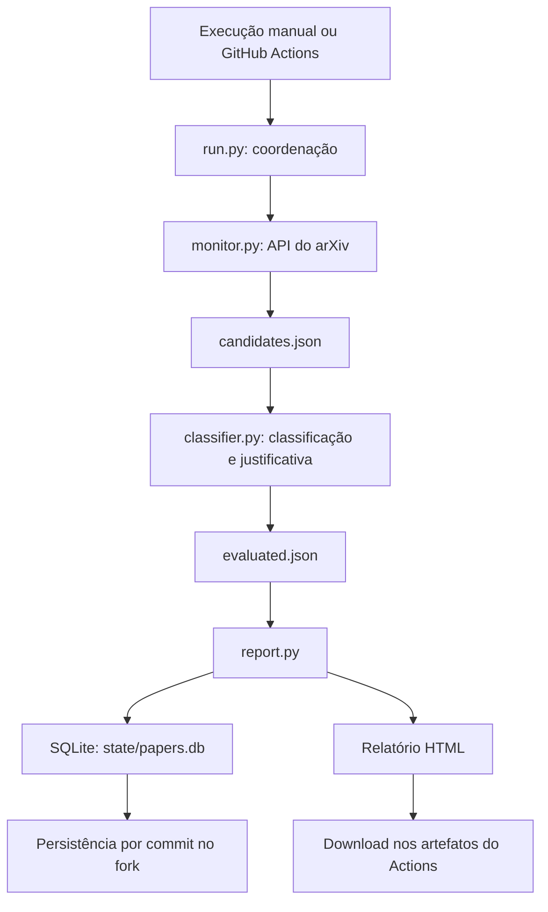

# Monitor de papers no arXiv

Prova de conceito desenvolvida por Lilian Morais Brum para o desafio de Automação de Processos da Unidade EMBRAPII DCC-UFMG.

Consulta o arXiv, seleciona artigos com evidências de Engenharia de Software e Sistemas Inteligentes, atribui notas explicáveis de 0 a 5, armazena metadados em SQLite e gera um relatório HTML.

O enunciado original está em [docs/desafio-original.md](docs/desafio-original.md).

## Arquitetura



## Requisitos

- Python 3.14.
- Git.
- Acesso à internet para consultar o arXiv.
- Navegador para visualizar o relatório.

A solução utiliza apenas a biblioteca padrão do Python. Não exige instalação de pacotes, chave de API ou serviço pago.

## Windows — PowerShell

Para uma instalação nova:

```powershell
git clone https://github.com/Lilianbrum/poc-is.git
Set-Location poc-is
py -3.14 -m venv .venv
.\.venv\Scripts\python.exe -m unittest discover -s tests -v
.\.venv\Scripts\python.exe .\src\run.py
Start-Process .\reports\latest.html
```

Se já possui o projeto, utilize a pasta e o ambiente existentes.

## Linux e macOS

Com Python 3.14 instalado:

```bash
git clone https://github.com/Lilianbrum/poc-is.git
cd poc-is
python3.14 -m venv .venv
.venv/bin/python -m unittest discover -s tests -v
.venv/bin/python src/run.py
```

Abra `reports/latest.html` no navegador.

No Linux:

```bash
xdg-open reports/latest.html
```

No macOS:

```bash
open reports/latest.html
```

Não é necessário ativar o ambiente virtual: os comandos usam diretamente seu interpretador.

## Consulta e classificação

A consulta busca até 100 candidatos, ordenados pela data de submissão, usando a categoria cs.SE e expressões relacionadas a Engenharia de Software.

O classificador procura conceitos no título e no resumo. Normaliza maiúsculas, espaços e hífens e agrupa variações como LLM, LLMs e large language models.

Um artigo é selecionado somente quando apresenta evidências lexicais dos dois temas.

| Nota | Critério |
| --- | --- |
| 0 | Nenhum conceito encontrado |
| 1–2 | Conceitos de apenas um tema; excluído |
| 3 | Um conceito de cada tema |
| 4 | Três conceitos no total, cobrindo os dois temas |
| 5 | Quatro ou mais conceitos, cobrindo os dois temas |

Para os selecionados, a fórmula é: 3 + min(2, total de conceitos − 2).

A justificativa registra os conceitos identificados. As expressões encontradas ficam no campo `evidence` de `data/evaluated.json`.

A nota representa cobertura lexical da temática, não qualidade científica ou probabilidade de relevância.

## Armazenamento e deduplicação

O banco `state/papers.db` guarda todos os candidatos avaliados, incluindo:

- Identificador arXiv.
- Título, autores, resumo, datas, categorias e link.
- Nota, seleção, justificativa e evidências.
- Versão do classificador.
- Datas da primeira e da última detecção, em UTC.

O identificador sem o sufixo de versão é a chave única. Novas versões atualizam o mesmo registro.

“Visto pela primeira vez” significa ausente do banco antes da execução. Não significa necessariamente publicado naquele dia. Artigos existentes que mudam de classificação não entram nesse contador.

O banco versionado contém a base obtida durante a demonstração. Quem clonar o projeto herdará esses registros.

## Relatório

O arquivo `reports/latest.html` apresenta os selecionados da consulta atual, incluindo artigos já conhecidos.

Contém metadados, resumo original, nota e justificativa. As avaliações de todos os candidatos ficam em `data/evaluated.json`.

O sistema exibe o relatório em HTML; não envia e-mails.

## Automação no GitHub Actions

O arquivo `.github/workflows/monitor.yml` configura:

- Execução diária às 12h17 UTC, equivalente a 09h17 em UTC−3.
- Execução manual em Actions → Monitor arXiv → Run workflow.
- Testes antes do monitoramento.
- Persistência do banco por commit na branch main.
- Relatório e avaliações disponíveis como artefato por 30 dias.

O horário agendado pode sofrer atrasos. Em forks, pode ser necessário habilitar os workflows na aba Actions.

A permissão `contents: write` permite salvar o banco. Políticas do repositório ou proteção de branch podem impedir esse salvamento.

As execuções desse workflow são serializadas. Alterações externas na branch durante uma execução ainda podem causar conflito no push.

Para acessar o relatório, abra uma execução bem-sucedida, baixe o artefato `relatorio-arxiv-...`, extraia o ZIP e abra `reports/latest.html`.

## Sincronização local

Antes de executar localmente:

```bash
git pull --ff-only origin main
```

Se houver alterações locais no banco, elas precisam ser conciliadas antes de um novo pull.

## Tratamento de falhas

O comando `src/run.py` interrompe o fluxo quando uma etapa falha.

Um relatório anterior pode permanecer no disco. Confira a data de geração para não confundi-lo com um resultado atualizado.

## Validação

Seis testes verificam:

1. Exigência dos dois temas.
2. Inclusão de exemplo com os dois temas.
3. Ausência de pontuação duplicada por aliases.
4. Normalização de hífens.
5. Exclusão de exemplo sem relação.
6. Limite de cinco pontos.

Também foram verificadas a execução no Windows, a execução no GitHub Actions em Linux e a deduplicação em execuções consecutivas.

O macOS não foi testado diretamente. Os testes não medem a precisão da classificação em uma amostra revisada por especialistas.

## Limitações

- Limite de 100 candidatos por consulta, sem paginação.
- Não há garantia de recuperar todos os artigos entre execuções ou após períodos sem execução.
- A classificação lexical pode gerar falsos positivos e perder sinônimos, negações ou relações implícitas.
- A presença dos dois temas não comprova uma relação semântica entre eles.
- Os dicionários privilegiam expressões em inglês.
- Dependência da disponibilidade do arXiv, sem retentativas automáticas.
- O SQLite versionado pode aumentar o tamanho do repositório ao longo do tempo.

## Evoluções possíveis

Paginação com controle de datas, recuperação de períodos perdidos, retentativas, avaliação em amostra rotulada, comparação com classificação semântica, banco externo e notificações.

## Referência

[Manual da API do arXiv](https://info.arxiv.org/help/api/user-manual.html)